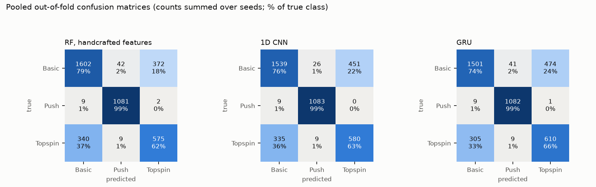
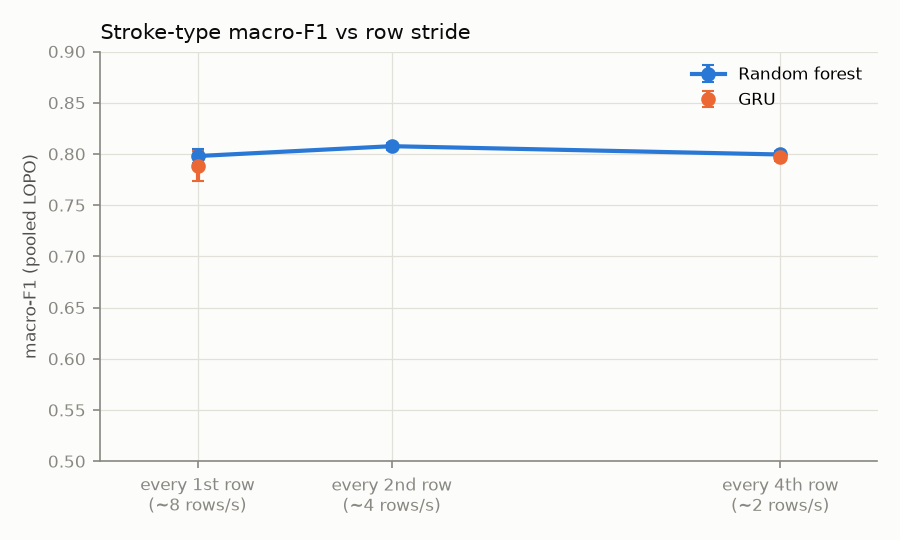
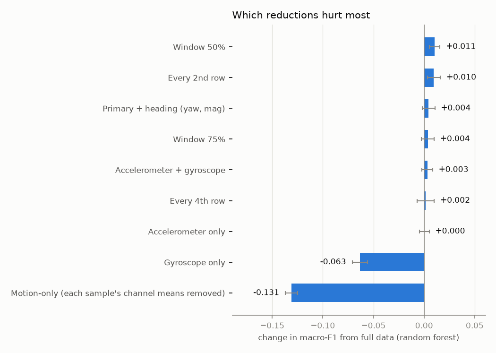
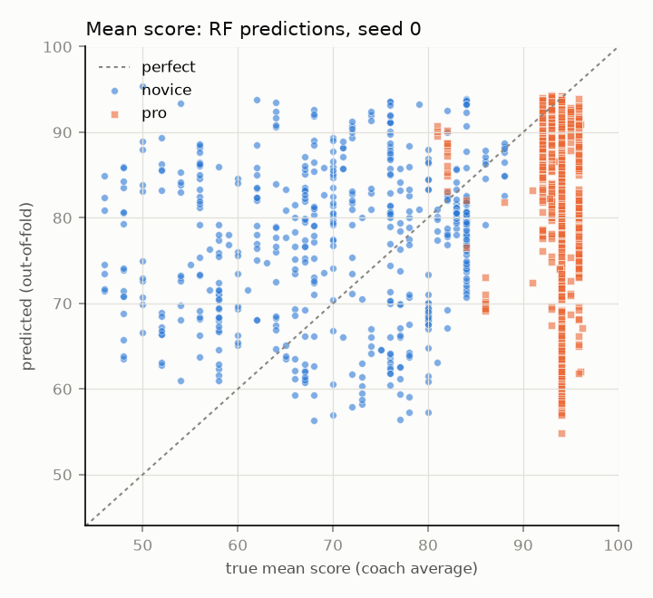
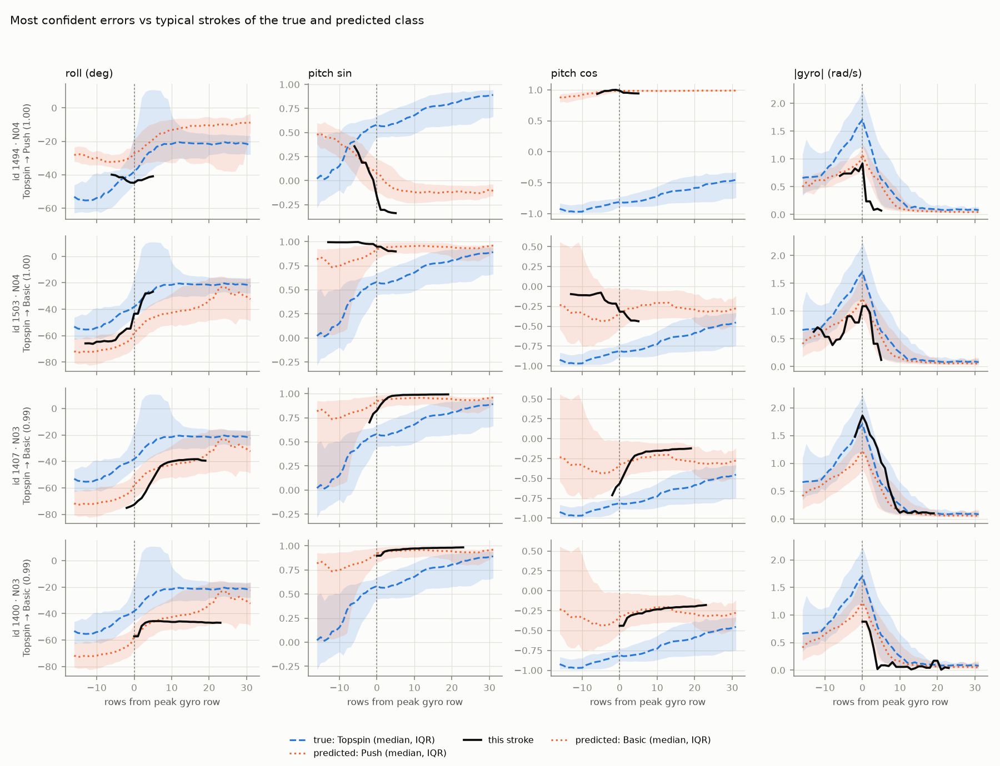

# Racket IMU Motion Inference

[](https://github.com/bhavishyabondalapati/racket-imu-motion-inference/actions/workflows/tests.yml)

This project takes a public dataset of table tennis forehands, recorded with a single motion sensor (IMU) on the racket, and measures what can be inferred reliably from that sensor alone: the stroke type (Basic, Topspin, Push), the coaches' quality score, and whether the player is a novice or a professional. Every result is measured on a player the model has never seen (leave-one-player-out), and a sparsity ablation shows how much sensor data is actually needed and where the predictions fail.

## Dataset and credit

> Sahar S. Tabrizi, Vajiheh Javani, Saeid Pashazadeh. *Data Acquired by a Single Object Sensor (IMU) of Table Tennis Forehand Strokes.* Mendeley Data, Version 3, 2020. DOI: [10.17632/b7bc9y232m.3](https://doi.org/10.17632/b7bc9y232m.3). Licensed under [CC BY 4.0](https://creativecommons.org/licenses/by/4.0/).

The data and its original analysis belong to these authors. This project's contribution is its own evaluation protocol (leave-one-player-out), analysis, ablations, and inference interface. It makes no claim of novelty over the original work. The raw data is not redistributed here: download it from Mendeley Data (see Setup).

> **Status: all milestones D1-D9 are complete.** Every number below comes from `results/SUMMARY.md`, which `make report` builds from the saved runs in `results/` (each with the commit it ran from). Design decisions are in [docs/DESIGN.md](docs/DESIGN.md); decisions taken while the owner was offline, and open questions, are in [docs/REVIEW_QUEUE.md](docs/REVIEW_QUEUE.md).

## Results

All results are on players the model never saw: 15-fold leave-one-player-out cross-validation, pooled out-of-fold predictions, mean ± std over 3 seeds, CPU. Data: 1344 strokes from 15 players ([docs/DATASET.md](docs/DATASET.md) lists every exclusion).

### Stroke type (Basic, Push, Topspin)

| model | macro-F1 | accuracy |
|---|---|---|
| Majority class | 0.222 | 0.500 |
| Random forest, handcrafted features | **0.798 ± 0.007** | 0.808 ± 0.006 |
| 1D CNN | 0.786 ± 0.016 | 0.794 ± 0.008 |
| GRU | 0.788 ± 0.014 | 0.792 ± 0.017 |

- Push is recognised almost perfectly (99% recall). Almost all errors are basic/topspin confusions.
- **Shortcut checks.** A forest given only each stroke's *average* sensor values scores 0.803, as well as every full model. Removing those averages drops it to 0.667. So the models mostly use the racket's static angle, not the swing's motion. This fits real racket-face differences between push and drive strokes, but a recording-session artifact cannot be ruled out. Heading (yaw, magnetometer) adds nothing (+0.004).
- **Calibration.** Temperature scaling fitted on 2 validation players made calibration worse on unseen players for every model, so the confidences reported are uncalibrated.



### How much sensor data is needed? (sparsity ablation)

Only two reductions hurt: removing each stroke's average values (−0.131 macro-F1 for the forest, −0.159 for the GRU) and keeping only the gyroscope (−0.063). Keeping every 4th row (about 2 rows per second), halving the window, or using the accelerometer alone all stay within about 0.01 of full data. The accelerometer measures the direction of gravity, which is the racket's orientation, and orientation is what the models use.




### Stroke quality (coach scores)

| mean of C1-C5 | MAE (points) | Spearman |
|---|---|---|
| Level-only baseline (training mean for the player's level) | **4.98** | 0.574 |
| Random forest | 10.85 ± 0.02 | 0.281 ± 0.002 |
| GRU | 9.90 ± 0.26 | 0.297 ± 0.023 |

**The models do not judge stroke quality beyond the player's level.** Neither beats the level-only baseline on any of the 6 targets (the rule was fixed before the run). Within novices they rank strokes only weakly (Spearman 0.13-0.17); within pros the ranking is negative.



### Skill level and transfer between groups

- Novice vs pro: the random forest reaches 0.772 macro-F1 (majority 0.324). **Caveat:** every novice was recorded on one day and every pro on other days, so this may partly reflect recording sessions rather than skill.
- Stroke type transfers across groups: training on pros and testing on novices scores higher than training on other novices (+0.076 macro-F1); the reverse loses only 0.030.
- Quality does not transfer: a model trained on one level is off by 12.5 to 22.4 more points on the other, because scores mostly track level.

### Errors and speed

- The most confident errors come from 3 novices. Their racket angle matches the wrong class, which is consistent with the orientation finding ([docs/ERRORS.md](docs/ERRORS.md)).
- `racketimu.infer.infer()` takes a median of **40.3 ms** (p95 40.9 ms) per stroke on an Apple M4 Pro CPU.



### Limitations

- Table tennis, not tennis; forehands only; shadow strokes without a ball.
- No video or motion capture, so body motion cannot be inferred or checked.
- 16 players (15 usable), one sensor position.
- About 8 rows per second observed (100 Hz / 70 Hz stated), which probably undersamples the swing.
- Stroke type is recognised from static racket angle; stroke types and skill levels were each recorded in separate sessions, so session artifacts cannot be ruled out.
- Only coach-averaged scores are published, so coach agreement (a ceiling for quality prediction) is unknown.
- Confidences are uncalibrated.

**Future work:** record synchronized racket-IMU and video or motion capture, at a higher rate and with stroke types and levels mixed within sessions, to move from stroke recognition to body-motion inference.

## Tools and libraries

| Library | Why |
|---|---|
| numpy, pandas | Arrays and tables for the IMU streams and stroke metadata |
| scipy | Spearman correlation and temperature fitting |
| scikit-learn | Random forests (classification and regression) and metrics; its joblib saves the deployable models |
| torch | Small 1D CNN and GRU models; runs on CPU for reported results (Apple `mps` is opt-in for quick local runs) |
| matplotlib | Stroke plots, confusion matrices, reliability diagrams, ablation and quality figures |
| pyyaml | Config file |
| pyarrow | Lets pandas write `strokes.parquet` |
| pytest, ruff | Tests and lint/format, run locally and in GitHub Actions |

The code and dependencies from the earlier self-recorded plan (video sync, MediaPipe pose) are kept under the git tag `recording-plan-archive`.

## File structure

```
CLAUDE.md                        project spec, ground rules, and the owner's decisions
README.md                        this file
pyproject.toml                   package definition with exact dependency pins, ruff and pytest settings
requirements.txt                 installs the package plus dev tools from pyproject.toml
Makefile                         one command per step (test, lint, inspect ... report, all)
.gitignore                       keeps data, videos, checkpoints, models, secrets, and envs out of git
.github/workflows/tests.yml      CI: lint and tests on every push (pinned Ubuntu runner)
configs/default.yaml             every threshold, window size, seed, and pre-registered check rule
data/raw/, data/interim/         raw dataset (data/raw/tabrizi2020/) and intermediate files (git-ignored)
data/processed/                  strokes.parquet (git-ignored, rebuilt by `make preprocess`)
models/                          deployable models from `make train-final` (git-ignored)
src/racketimu/config.py          loads the YAML config and applies overrides
src/racketimu/seed.py            seeds Python/NumPy/torch; picks the device (cpu by default)
src/racketimu/io.py              loads the raw stroke files, converts units, attaches labels/scores, marks exclusions
src/racketimu/datacard.py        builds docs/DATASET.md from the loaded data
src/racketimu/dataset.py         48-row windows around the peak gyro row, sin/cos angles, LOPO and validation splits
src/racketimu/features.py        handcrafted, mean-only, motion-only, and length features for the forests
src/racketimu/models.py          small 1D CNN and GRU with masked pooling
src/racketimu/train.py           fold-local scaling and the training loop with early stopping
src/racketimu/evaluate.py        metrics, ECE, reliability tables, temperature scaling
src/racketimu/classify.py        D3: stroke type under LOPO for every model
src/racketimu/classify_report.py D3 tables and shortcut checks
src/racketimu/ablation.py        D6: sparsity conditions (stride, sensors, window, motion-only)
src/racketimu/quality.py         D4: coach-score prediction, baselines, the beat-the-level rule
src/racketimu/skill.py           D5: novice vs pro, and cross-group training
src/racketimu/errors.py          D7: confident errors, per-player accuracy, error rates
src/racketimu/infer.py           D8: public infer() interface and CLI
src/racketimu/report.py          D9: builds results/SUMMARY.md from saved results
src/racketimu/runinfo.py         records commit, clean/dirty state, hardware, and versions for every run
src/racketimu/plots.py           all figures
src/racketimu/assets.py          SHA-256 helpers (from M0)
scripts/                         one thin command-line script per step (inspect_dataset, preprocess, classify,
                                 run_ablation, quality, skill, errors, train_final, latency, report,
                                 check_large_files)
tests/                           pytest on synthetic data only (conftest builds a fake copy of the file layout)
docs/DESIGN.md                   every design decision, alternatives, reasons, and results per milestone
docs/DATASET.md                  dataset card (generated by `make inspect`)
docs/ERRORS.md                   error analysis (generated by `make errors`)
docs/REVIEW_QUEUE.md             decisions taken while the owner was offline, and open questions
docs/MORNING_SUMMARY.md          status and headline numbers after the overnight run
docs/figures/                    D2 review figures, D6 and D7 figures
results/<run>/                   one folder per run: report.md, metrics.json, predictions, config.yaml, run.json, figures
results/SUMMARY.md               all headline results (generated by `make report`)
```

## Setup

```bash
conda create -n racket-imu-motion-inference python=3.11
conda activate racket-imu-motion-inference
make install          # same as: pip install -r requirements.txt
```

Download the dataset: open https://data.mendeley.com/datasets/b7bc9y232m/3, click "Download All", and unzip it into `data/raw/tabrizi2020/`.

## How to run

```bash
make test             # unit tests (synthetic data only)
make lint             # ruff + large-file check
make inspect          # D1: regenerate docs/DATASET.md
make preprocess       # D2: build data/processed/strokes.parquet and the review figures
make classify         # D3: stroke type under LOPO (~11 min on CPU)
make ablation         # D6: sparsity ablation (~11 min)
make quality          # D4: coach-score prediction (~6 min)
make skill            # D5: novice vs pro and cross-group (~5 min)
make errors           # D7: regenerate docs/ERRORS.md
make latency          # D8: train the deployable models, then time inference
make report           # D9: regenerate results/SUMMARY.md
make all              # D2 to D9 in order
```

Run inference on one player's strokes, or one raw stroke file:

```bash
python -m racketimu.infer --player P04 --out p04.json
```

```bash
python -m racketimu.infer --csv data/raw/tabrizi2020/Raw/Sensory-Data/77.csv
```

Or from Python: `from racketimu.infer import infer; infer(imu_window, fs=8.0)`. `imu_window` is one stroke's rows, shape [T, 8]: acc x/y/z in m/s², gyro x/y/z in rad/s, roll and pitch in degrees.

## How it was built

1. **M0, scaffold:** wrote the spec, created the conda env, installed the libraries and pinned the exact versions that resolved together, then added the config loader, seed utility, tests, Makefile, large-file guard, and CI. Then made CPU the default device.

2. **Switch to a public dataset:** replaced the self-recorded tennis plan with the Tabrizi et al. (2020) table tennis dataset and milestones D1 to D9. The Makefile placeholders were updated to match. The old plan's code was tagged `recording-plan-archive`, then removed: opencv-python, mediapipe, ahrs, the pose-model download, its config sections, and `data/sessions.yaml`.

3. **D1, data inspection:** inspected every file before writing code and reported the findings: about 8 rows per second instead of the stated 100 Hz, 223 cleaned samples with no accelerometer or gyroscope data, 5 score criteria (not 3 coaches), and several label spellings. With the owner's decisions, wrote the loader (`io.py`) and the generated dataset card (`make inspect`).

4. **D2, preprocessing:** each stroke file becomes one sample of 48 rows with its peak rotation rate at row 16, with a mask for padding. Pitch is encoded as sin/cos because it wraps at ±180°. Heading channels (yaw, magnetometer) are kept out of the main input to avoid a shortcut.

5. **D3, stroke type:** majority baseline, random forests (including shortcut checks), a small CNN and a GRU, all under 15-fold leave-one-player-out with 3 seeds. A reproduction check found and fixed a seeding bug before the final run.

6. **D6, sparsity ablation:** the same protocol rerun with fewer rows, fewer sensors, shorter windows, and with each sample's average removed. Only removing the static orientation (or keeping only the gyroscope) hurt.

7. **D4, stroke quality:** predicted each coach criterion and the mean against three baselines. Neither model beat the level-only baseline, so the models do not judge quality beyond the player's level.

8. **D5, skill level:** novice vs pro under leave-one-player-out, then stroke-type and quality models trained on one level and tested on the other. Found that level is fully confounded with recording day.

9. **D7, error analysis:** generated `docs/ERRORS.md` with the most confident errors, the least confident strokes, per-player accuracy, and failure plots. Most errors are basic/topspin confusions, and confident errors follow the racket angle of the wrong class.

10. **D8, inference interface:** `racketimu.infer.infer()` and a CLI, backed by random forests retrained on all used strokes; about 40 ms per stroke on a laptop CPU.

11. **D9, reporting:** `make report` builds `results/SUMMARY.md` from the saved runs, and this README was filled in from it. The `v0.1` tag is left for the owner after review.

## Key concepts

- **Leave-one-player-out (LOPO) cross-validation:** train on all players but one, test on the one left out, repeat for each player. Strokes from one player look alike, so a random split would leak a player's style into training and overstate accuracy. LOPO measures what matters: performance on a new person. Here it has 15 folds, because one player (P06) has no usable accelerometer or gyroscope data.
- **Inspect before modelling:** the dataset description said 100 Hz and 1570 samples; the files showed about 8 rows per second, and 223 of those samples have no accelerometer or gyroscope signal. Building on the description alone would have produced misleading results.
- **Shortcut learning:** a model can score well by picking up something that differs between recording sessions (here, absolute heading) instead of the stroke itself. Keeping heading out of the main input, and testing with and without it, guards against that.
- **Angle wrap-around:** an angle like pitch jumps from +179° to −179° when it crosses ±180°. Encoding it as sin and cos keeps the input continuous.
- **Pooled out-of-fold metrics:** predictions from every test fold are combined before computing the confusion matrix and macro-F1. Several players have only one or two stroke classes, so a per-player macro-F1 would be undefined or misleading.
- **Reproducibility:** exact dependency pins, one config file for all parameters, and one seed function mean anyone can rerun the pipeline and get the same numbers.
- **Config over constants:** thresholds live in `configs/default.yaml`, not in code, so experiments change a file, not the source, and each run saves the config it used.
- **CPU for reported results:** GPU backends like MPS can give slightly different numbers run to run. Reported numbers use CPU so they can be reproduced exactly.
- **Pre-registered decision rules:** the thresholds for the shortcut checks and the "beats the level-only baseline" rule were committed before the runs, so the result could not move the goalposts.
- **Baselines that use what you already know:** a quality model must beat "the average score for this player's level", not just the overall average. Here it does not, which is the honest finding.
- **Confounding:** when two things always occur together (stroke type and recording block; skill level and recording day), a model cannot tell which one it learned. Leave-one-player-out does not fix this.
- **Calibration (ECE, temperature scaling):** a model is calibrated if its 80%-confidence predictions are right 80% of the time. Temperature scaling fixes this on similar data; here it did not transfer to new players.
- **CI:** GitHub Actions runs lint and tests on every push, so a broken change is caught immediately.
