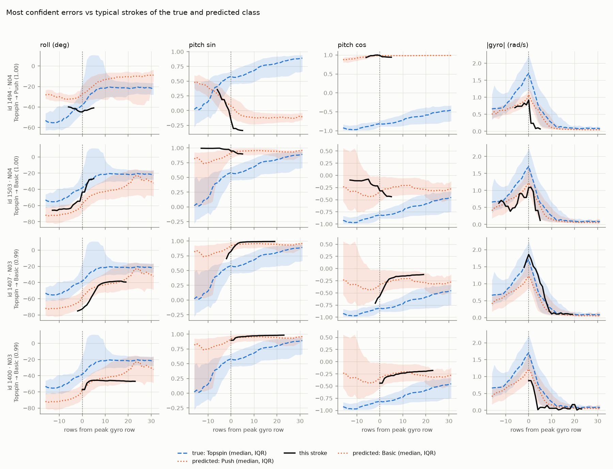

# Error analysis (D7)

> Generated by `make errors` (`scripts/errors.py`) from `results/d3_20261101T032754Z` (model: random forest on handcrafted primary features; probabilities averaged over the 3 seeds, uncalibrated). Code commit `90cabe34fd`. Do not edit by hand.

## Patterns found

- **Where the errors are:** 257 of 1344 strokes are misclassified. The largest error type is BASIC predicted as TOPSPIN (124); basic/topspin confusions in either direction account for 237 of 257 errors.
- **Confident errors:** of the 10 most confident mistakes, 7 are TOPSPIN predicted as BASIC, 2 are TOPSPIN predicted as PUSH, 1 is PUSH predicted as BASIC; they come from 3 players (N04, N03, N05). Their confidence ranges from 0.98 to 1.00.
- **Unconfident strokes:** the 10 lowest-confidence strokes have confidence 0.40-0.49; 6 of them are still correct.
- **Per-player spread:** accuracy ranges from 0.400 (N08) to 1.000. Mean per-player accuracy is 0.775 for novices and 0.832 for pros (players weighted equally).
- **Stroke length:** error rate by number of rows in the stroke file: 2-15 rows 0.093 (n=313), 16-25 rows 0.145 (n=489), 26-40 rows 0.260 (n=404), 41+ rows 0.377 (n=138).
- **Class and level:** the highest error rate is TOPSPIN by novices (0.489, n=94); push is almost never misclassified (0.008 overall).
- **Peak on the first row:** error rate 0.092 for the 238 strokes whose peak is on the first logged row, vs 0.212 for the rest.

These describe the out-of-fold predictions only. The leak check in D3 suggests the model relies mostly on static racket orientation, which is the lens for the failure plots below.

## Error types

| true | pred | errors |
|---|---|---|
| BASIC | TOPSPIN | 124 |
| TOPSPIN | BASIC | 113 |
| BASIC | PUSH | 14 |
| PUSH | BASIC | 3 |
| TOPSPIN | PUSH | 3 |

## 10 misclassified strokes with the highest confidence

| sample_id | test_player | level | true | pred | confidence | n_rows | peak_row |
|---|---|---|---|---|---|---|---|
| 1494 | N04 | novice | TOPSPIN | PUSH | 0.997 | 12 | 6 |
| 1503 | N04 | novice | TOPSPIN | BASIC | 0.996 | 19 | 13 |
| 1407 | N03 | novice | TOPSPIN | BASIC | 0.994 | 22 | 2 |
| 1400 | N03 | novice | TOPSPIN | BASIC | 0.991 | 24 | 0 |
| 1403 | N03 | novice | TOPSPIN | BASIC | 0.989 | 29 | 7 |
| 1506 | N04 | novice | TOPSPIN | BASIC | 0.986 | 14 | 9 |
| 1469 | N04 | novice | PUSH | BASIC | 0.984 | 33 | 14 |
| 1580 | N05 | novice | TOPSPIN | PUSH | 0.982 | 111 | 85 |
| 1404 | N03 | novice | TOPSPIN | BASIC | 0.982 | 31 | 9 |
| 1502 | N04 | novice | TOPSPIN | BASIC | 0.982 | 14 | 0 |

## 10 lowest-confidence strokes

| sample_id | test_player | level | true | pred | confidence | n_rows | peak_row | correct |
|---|---|---|---|---|---|---|---|---|
| 682 | P05 | pro | PUSH | PUSH | 0.403 | 5 | 2 | True |
| 683 | P05 | pro | PUSH | PUSH | 0.427 | 2 | 0 | True |
| 1197 | N02 | novice | BASIC | PUSH | 0.459 | 37 | 23 | False |
| 1207 | N02 | novice | BASIC | BASIC | 0.468 | 31 | 8 | True |
| 1544 | N05 | novice | BASIC | TOPSPIN | 0.479 | 26 | 12 | False |
| 1531 | N05 | novice | BASIC | BASIC | 0.483 | 30 | 16 | True |
| 1211 | N02 | novice | BASIC | PUSH | 0.486 | 23 | 19 | False |
| 1200 | N02 | novice | BASIC | PUSH | 0.491 | 22 | 10 | False |
| 1191 | N02 | novice | BASIC | BASIC | 0.493 | 43 | 32 | True |
| 1528 | N05 | novice | BASIC | BASIC | 0.493 | 32 | 14 | True |

## Per test player (accuracy, lowest first)

| test_player | level | n | accuracy | classes | errors |
|---|---|---|---|---|---|
| N08 | novice | 50 | 0.4 | BASIC | 30 |
| P03 | pro | 60 | 0.667 | BASIC, PUSH, TOPSPIN | 20 |
| P02 | pro | 134 | 0.672 | BASIC, PUSH | 44 |
| N02 | novice | 42 | 0.69 | BASIC | 13 |
| N04 | novice | 100 | 0.69 | BASIC, PUSH, TOPSPIN | 31 |
| P04 | pro | 140 | 0.7 | BASIC, PUSH, TOPSPIN | 42 |
| N03 | novice | 99 | 0.747 | BASIC, PUSH, TOPSPIN | 25 |
| N05 | novice | 80 | 0.762 | BASIC, PUSH, TOPSPIN | 19 |
| P07 | pro | 150 | 0.853 | BASIC, PUSH, TOPSPIN | 22 |
| N06 | novice | 30 | 0.933 | BASIC, PUSH | 2 |
| P05 | pro | 115 | 0.939 | PUSH, TOPSPIN | 7 |
| N07 | novice | 50 | 0.98 | BASIC | 1 |
| P08 | pro | 179 | 0.994 | BASIC, PUSH, TOPSPIN | 1 |
| N01 | novice | 99 | 1.0 | BASIC, PUSH, TOPSPIN | 0 |
| P01 | pro | 16 | 1.0 | BASIC | 0 |

## Error rate by stroke length (raw rows)

| rows in stroke file | n | error rate |
|---|---|---|
| 2-15 | 313 | 0.093 |
| 16-25 | 489 | 0.145 |
| 26-40 | 404 | 0.26 |
| 41+ | 138 | 0.377 |

## Error rate by true class and level

| true | level | n | error_rate |
|---|---|---|---|
| BASIC | novice | 362 | 0.199 |
| BASIC | pro | 310 | 0.213 |
| PUSH | novice | 94 | 0.032 |
| PUSH | pro | 270 | 0.0 |
| TOPSPIN | novice | 94 | 0.489 |
| TOPSPIN | pro | 214 | 0.327 |

## Failure cases

`figures/d7/failure_cases.png`: the 4 most confident errors (dark line) against the median and interquartile band of their true class and of the predicted class, for roll, pitch and gyro magnitude.

